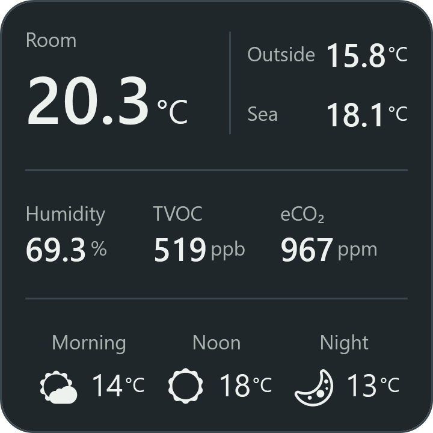
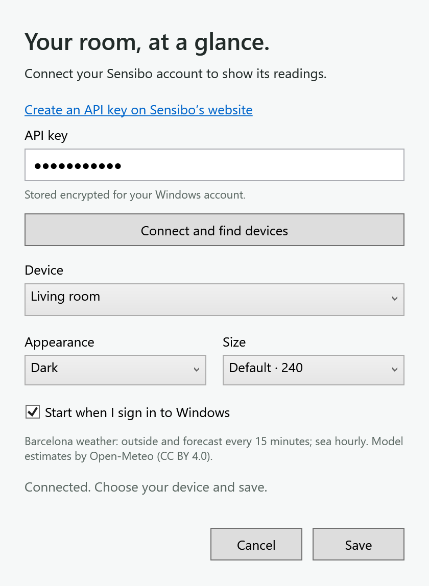

<p align="center">
  <picture>
    <source media="(prefers-color-scheme: dark)" srcset="docs/assets/logo-dark.png">
    
  </picture>
</p>

> Your room and Barcelona weather, at a glance. A compact, always-on-top Windows widget with indoor air readings, outdoor and sea temperatures, and a morning, noon, and night forecast.

## Table of contents

- [Screenshots](#screenshots)
- [Requirements](#requirements)
- [Build and check](#build-and-check)
- [Install for the current Windows user](#install-for-the-current-windows-user)
- [First connection](#first-connection)
- [Use](#use)
- [Network behavior](#network-behavior)
- [Barcelona weather](#barcelona-weather)
- [Code layout](#code-layout)
- [Uninstall](#uninstall)
- [Manual acceptance checks](#manual-acceptance-checks)
- [AI disclosure](#ai-disclosure)

## Screenshots

<table>
  <tr>
    <td align="center" valign="middle"></td>
    <td align="center" valign="middle"></td>
  </tr>
  <tr>
    <td align="center">Indoor air and Barcelona weather — sample readings.</td>
    <td align="center">Configuration — sample data.</td>
  </tr>
</table>

Both images are rendered from the current native WPF layouts with sample data. Alongside the Sensibo readings, the widget pulls in outside temperature, sea surface temperature, and morning/noon/night forecasts for Barcelona. Outside temperature and forecasts refresh every 15 minutes; sea temperature refreshes hourly.

## Requirements

- Windows 11 x64 (Windows 10 x64 may work but is not the primary test target).
- A Sensibo account and an internet connection. Air Pro identifies itself as `airq`.
- To build: **.NET SDK 11.0.100**, pinned in `global.json`. No Visual Studio installation is required.
- To run the published app: no separate .NET installation. The self-contained app includes runtime **11.0.0**.

## Build and check

Install SDK 11.0.100 from the [official .NET 11 download page](https://dotnet.microsoft.com/en-us/download/dotnet/11.0). From the repository root, run:

```powershell
powershell.exe -NoProfile -ExecutionPolicy Bypass -File .\scripts\build.ps1
```

If the SDK is installed in a separate directory, pass its executable explicitly without changing your system PATH:

```powershell
.\scripts\build.ps1 -DotnetPath "$env:LOCALAPPDATA\Microsoft\dotnet11\dotnet.exe"
```

The script verifies the exact SDK, restores with checked-in dependency lock files, builds Release with warnings treated as errors, runs the offline checks, and publishes to `artifacts/publish`. The first restore requires access to NuGet to download the pinned Windows runtime packs. There are no third-party packages. Keep the entire publish folder together: three WPF runtime DLLs must remain beside the executable to work around a [.NET 11 startup bug](https://github.com/dotnet/wpf/issues/11842). The installer copies these files automatically.

Build inputs are pinned by `global.json`, the runtime version in the app project, `NuGet.config`, and `packages.lock.json`. Deterministic compilation and normalized source paths are enabled; automatic Git-dependent source embedding and revision attributes are disabled so a source archive builds the same as a checkout. An independent rebuild from a second directory produced an identical executable; see `VALIDATION.md`. `artifacts/SHA256SUMS.txt` records the executable hash. Do not edit generated outputs. When intentionally updating the SDK/runtime, update their pins, run `dotnet restore SensiboDesktopWidget.slnx --force-evaluate`, review the lock-file changes, then rerun the build script.

To run only the offline checks after building:

```powershell
dotnet run --project tests/SensiboWidget.Tests -c Release --no-build --no-restore
```

The checks are a small dependency-free executable: a failed assertion exits nonzero. They cover device parsing, absent versus zero readings, partial updates, SSE framing, authenticated requests, rate-limit responses, cancellation, selected-device filtering, and monitor positioning. They never contact Sensibo or change startup registration.

## Install for the current Windows user

After a successful build:

```powershell
powershell.exe -NoProfile -ExecutionPolicy Bypass -File .\scripts\install.ps1 -Launch
```

This requires no administrator privileges. It:

1. Copies the published app to `%LOCALAPPDATA%\Programs\SensiboDesktopWidget`.
2. Creates **Sensibo Widget** in the Start menu.
3. Registers startup in `HKCU\Software\Microsoft\Windows\CurrentVersion\Run`, value `SensiboDesktopWidget`.
4. Opens the app when `-Launch` is supplied.

Use `-NoStartup` to install without startup registration. Startup means **Windows sign-in**, when the desktop is available. You can also change this option in the app's Settings. The execution-policy option applies to that PowerShell process only. Organization policy can still prevent scripts or unsigned executables from running.

For updates, quit the widget through its tray menu, rebuild, and run the installer again. Settings and the encrypted key are kept outside the application directory. This is a locally built, unsigned application; it has no automatic updater.

## First connection

1. Open [Sensibo API keys](https://home.sensibo.com/me/api).
2. Sign in with the same email as the phone app. Passwordless sign-in is available.
3. Create a key named, for example, **Desktop readings**.
4. Paste it into the widget's masked API-key field and click **Connect and find devices**.
5. Choose your device and click **Save**.

The app makes read-only API requests. A Sensibo key itself grants account control: do not share it. It is stored using Windows DPAPI with `CurrentUser` protection in `%LOCALAPPDATA%\SensiboDesktopWidget\api-key.bin`. The JSON settings file stores only device selection, appearance, and position. No API keys, readings, or HTTP response bodies are logged. A process running as the same Windows user can decrypt the key; DPAPI is not protection from a compromised user session.

## Use

- Drag anywhere on the widget. It snaps within 16 logical pixels of a monitor's usable edge, respecting the taskbar.
- Monitor identity and relative position are saved after dragging. Moving between displays accounts for per-monitor DPI; a missing display falls back to the primary monitor.
- Right-click for Settings, Reconnect, Move to main display, Hide, and Quit.
- Double-click the tray icon to show a hidden widget. `Esc` hides it; `Shift+F10` opens its menu when it has keyboard focus.
- The Room first layout is 240 × 240 logical pixels by default. Settings offers 240, 272, 296, or 320 pixels and System, Light, or Dark appearance. Older sizes below 240 are raised to 240 on load; saved position, theme, device, and key are preserved.
- A small amber dot indicates an unavailable connection, an offline device, an indoor measurement older than 15 minutes, or missing/outdated weather. Hover for timestamps and status. Unchanged indoor measurements may legitimately become old; the indicator is conservative, not proof of a sensor fault.
- Missing readings show `—`, never a fabricated zero. Air Pro's **eCO₂** is estimated from TVOC, not a direct CO₂ measurement.
- Always-on-top applies to ordinary desktop windows, not the Windows secure desktop or exclusive full-screen applications.

For a visual preview without an API key:

```powershell
.\artifacts\publish\SensiboWidget.exe --demo
```

Demo mode shows clearly identified sample room and weather readings in its tooltips and tray label. It does not save settings, change startup registration, or contact Sensibo or the weather services.

## Network behavior

The app uses the [Sensibo REST API and event stream](https://support.sensibo.com/api/) directly through .NET `HttpClient`:

- HTTPS only; authentication is sent through `X-Api-Key`, never in URLs.
- Gzip compression is requested. Redirects are disabled to avoid forwarding credentials.
- The SSE connection supplies measurement updates. On its `hello` event the app reads an initial snapshot, and refreshes the snapshot approximately every 15–17 minutes while receiving events/heartbeats.
- Partial updates are merged. Changes for other devices and accessory sensors are ignored.
- A missing heartbeat triggers reconnection. Failures use increasing delays with jitter, respect `Retry-After`, and retain previous readings with a connection warning.
- A slow snapshot is attempted between stream retries. Invalid credentials stop retries until Settings or Reconnect is used.

## Barcelona weather

- Outside air temperature and the hourly forecast come from the [Open-Meteo Weather API](https://open-meteo.com/en/docs), using Barcelona city coordinates (41.3874, 2.1686). They refresh every **15 minutes**.
- Sea surface temperature comes from the [Open-Meteo Marine API](https://open-meteo.com/en/docs/marine-weather-api), using a sea grid cell near the Barcelona coast (41.38, 2.20). It refreshes once an **hour**, independently of the outside temperature. This is a model estimate of surface water, not a reading from a beach thermometer; refreshing does not mean the underlying model updates hourly.
- Morning, Noon, and Night show today's **08:00, 12:00, and 21:00**, in **Europe/Madrid** time. Earlier periods remain visible until the Barcelona date changes. Hover a forecast to see its date, time, and condition in words. UTC timestamps are converted with daylight-saving rules, independently of the computer's timezone.
- All temperatures show **°C**. Missing data shows `—`. Failed requests retain previous readings and dim the affected data; tooltips show when values were valid and fetched. Data older than twice its refresh interval is also marked stale. Forecasts from a previous date are never reused as today's forecast.
- Weather starts independently of the Sensibo connection. Startup fetches both sources once, then follows their separate schedules. Sleep/wake does not replay missed requests. Errors wait until the next scheduled attempt, or longer if the service sends `Retry-After`. Requests time out after 20 seconds and are cancelled on exit.
- No additional key is required. Weather uses its own HTTPS client, never receives the Sensibo key, and sends only the fixed Barcelona coordinates. Redirects are disabled. Weather responses are kept in memory, not logged or saved.

Weather data by **[Open-Meteo](https://open-meteo.com/)**, licensed under **[CC BY 4.0](https://creativecommons.org/licenses/by/4.0/)**; temperatures are rounded for display and weather codes are represented as icons. Attribution is also available in the widget's tooltips, Settings, and right-click menu. The configured free endpoints are for [non-commercial use](https://open-meteo.com/en/terms); commercial deployments need an appropriate service plan. This does not change the project's MIT code license.

The normal build runs offline checks, including refresh schedules, missing values, rate limits, cancellation, midnight, and daylight-saving transitions. To additionally check the real public weather endpoints (no Sensibo account is used):

```powershell
dotnet run --project tests/SensiboWidget.Tests -c Release --no-build --no-restore -- --weather-live
```

## Code layout

- `src/SensiboWidget.Core`: readings, JSON parsing, REST/SSE client, Barcelona weather client and refresh schedules, pure monitor-placement calculations.
- `src/SensiboWidget`: WPF windows, tray icon, per-monitor Windows integration, encrypted storage, startup registration.
- `tests/SensiboWidget.Tests`: offline assertions using fake HTTP responses; no real credentials.
- `scripts`: reproducible build and per-user install/uninstall entry points.

UI updates run on the WPF dispatcher. Network work runs asynchronously with cancellation. The modest UI uses code-behind for window behavior; domain and network logic are independent of WPF.

## Uninstall

Quit from the tray, then run from the repository:

```powershell
powershell.exe -NoProfile -ExecutionPolicy Bypass -File .\scripts\uninstall.ps1
```

Alternatively, run the copy in `%LOCALAPPDATA%\Programs\SensiboDesktopWidget\uninstall.ps1`. Settings and the encrypted key are preserved by default. Add `-RemoveSettings` to remove them too. Revoke the key separately on Sensibo's API-key page if it is no longer needed.

## Manual acceptance checks

Use a real account to verify initial readings and changes; disconnect and reconnect the network; move the widget among all monitors with their actual DPI settings; restart it to verify position; disconnect the saved monitor to verify recovery; and sign out/in to verify automatic startup. Offline checks cannot establish these environmental behaviors.

## AI disclosure

This entire project, including its code, documentation, and logo, was generated using artificial intelligence under human direction.
